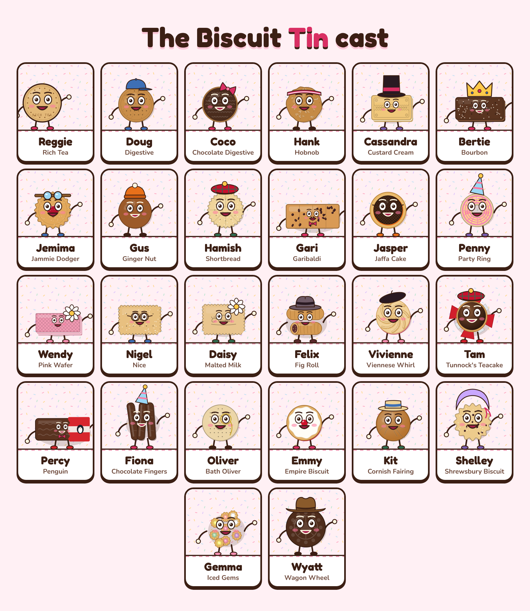

# The Biscuit Tin cast

A character and a 16-second Instagram Reel for every biscuit on the site: these 25, plus
Reggie the Rich Tea in `../reggie/`. Each Reel is 1080 × 1920 at 30fps with an original
soundtrack (no music licensing needed), and keeps every word inside Instagram's safe area.



## Posting

- **Video:** `videos/<biscuit>.mp4`. Post it as a Reel.
- **Cover:** `covers/<biscuit>.png`. Choose it under Edit cover → Add from camera roll.
- **Caption:** copy it from below.
- **Order:** start with Reggie, then one a day in the order below. That's nearly a month of
  daily Reels, with the gags mixed so no two in a row are the same kind.

| # | Character | Biscuit | Gag |
|---|-----------|---------|-----|
| 1 | Reggie | Rich Tea | Dunk test (it doesn't go well) |
| 2 | Coco | Chocolate Digestive | The big reveal: "TECHNICALLY THE BOTTOM" |
| 3 | Hamish | Shortbread | Party: "HAPPY HOGMANAY!" |
| 4 | Cassandra | Custard Cream | The big reveal: "NO CUSTARD INSIDE" |
| 5 | Doug | Digestive | Dunk test (6 seconds) |
| 6 | Bertie | Bourbon | The big reveal: "NOTHING TO DO WITH WHISKEY" |
| 7 | Penny | Party Ring | Party: "PARTY!" |
| 8 | Jemima | Jammie Dodger | The big reveal: "TOTAL BLUFF" |
| 9 | Hank | Hobnob | Dunk test (8 seconds) |
| 10 | Gari | Garibaldi | The big reveal: "SQUASHED FLY BISCUIT" |
| 11 | Vivienne | Viennese Whirl | Party: "TWIRL!" |
| 12 | Jasper | Jaffa Cake | The big reveal: "LEGALLY A CAKE" |
| 13 | Gus | Ginger Nut | Dunk test (10 seconds) |
| 14 | Nigel | Nice | The big reveal: "NICE? NEECE?" |
| 15 | Fiona | Chocolate Fingers | Party: "TA-DA!" |
| 16 | Daisy | Malted Milk | The big reveal: "MOO." |
| 17 | Wendy | Pink Wafer | Dunk test (it doesn't go well) |
| 18 | Felix | Fig Roll | The big reveal: "TOP SECRET" |
| 19 | Kit | Cornish Fairing | Party: "ROLL UP! ROLL UP!" |
| 20 | Percy | Penguin | The big reveal: "NO PLANE TICKETS" |
| 21 | Tam | Tunnock's Teacake | Refuses to dunk |
| 22 | Oliver | Bath Oliver | The big reveal: "ACTUAL PORTRAIT" |
| 23 | Gemma | Iced Gems | Party: "HATS OFF!" |
| 24 | Emmy | Empire Biscuit | The big reveal: "RENAMED" |
| 25 | Wyatt | Wagon Wheel | The shrink test: "SAME SIZE AS EVER" |
| 26 | Shelley | Shrewsbury Biscuit | The big reveal: "FAMOUS SINCE 1700" |

## Captions

### 2. Coco the Chocolate Digestive

`videos/chocolate-digestive.mp4` · `covers/chocolate-digestive.png`

```
Meet Coco. Coco is a Chocolate Digestive, and Coco has just had some news 😳

Biscuit makers coat the underside, so technically the chocolate is on the bottom. Chocolate side up or down? 👇

Every biscuit, with its history and a recipe, is on the site. Link in bio 🍪

#ChocolateDigestive #ChocolateBiscuits #GreatDebate #BritishBiscuits #Biscuits #TeaTime #TeaAndBiscuits #BiscuitTin
```

### 3. Hamish the Shortbread

`videos/shortbread.mp4` · `covers/shortbread.png`

```
Meet Hamish. Hamish is a Shortbread, and Hamish has three ingredients and centuries of pride 🏴󠁧󠁢󠁳󠁣󠁴󠁿

The classic ratio is 1 sugar, 2 butter, 3 flour. Easy to remember, even after a dram.

Every biscuit, with its history and a recipe, is on the site. Link in bio 🍪

#Shortbread #ScottishShortbread #Hogmanay #BritishBiscuits #Biscuits #TeaTime #TeaAndBiscuits #BiscuitTin
```

### 4. Cassandra the Custard Cream

`videos/custard-cream.mp4` · `covers/custard-cream.png`

```
Meet Cassandra. Cassandra is a Custard Cream, and Cassandra has a secret 🤫

There's no actual custard inside. The flavour comes from custard powder and vanilla.

Every biscuit, with its history and a recipe, is on the site. Link in bio 🍪

#CustardCream #VictorianBiscuits #BiscuitFacts #BritishBiscuits #Biscuits #TeaTime #TeaAndBiscuits #BiscuitTin
```

### 5. Doug the Digestive

`videos/digestive.mp4` · `covers/digestive.png`

```
Meet Doug. Doug is a Digestive. Doug does not panic in a crisis, or a cuppa ☕

He's been the nation's go-to dunker since 1892, and he knows it.

Every biscuit, with its history and a recipe, is on the site. Link in bio 🍪

#Digestive #McVities #DunkTest #BritishBiscuits #Biscuits #TeaTime #TeaAndBiscuits #BiscuitTin
```

### 6. Bertie the Bourbon

`videos/bourbon.mp4` · `covers/bourbon.png`

```
Meet Bertie. Bertie is a Bourbon, and Bertie would like you to bow 👑

He's named after the French royal House of Bourbon. He has nothing whatsoever to do with whiskey.

Every biscuit, with its history and a recipe, is on the site. Link in bio 🍪

#Bourbon #BourbonBiscuit #BiscuitFacts #BritishBiscuits #Biscuits #TeaTime #TeaAndBiscuits #BiscuitTin
```

### 7. Penny the Party Ring

`videos/party-ring.mp4` · `covers/party-ring.png`

```
Meet Penny. Penny is a Party Ring. Penny has never not been at a party 🎉

No two Party Rings are quite alike: the feathered icing is dragged through by hand, wet.

Every biscuit, with its history and a recipe, is on the site. Link in bio 🍪

#PartyRing #PartyRings #Nostalgia #BritishBiscuits #Biscuits #TeaTime #TeaAndBiscuits #BiscuitTin
```

### 8. Jemima the Jammie Dodger

`videos/jammie-dodger.mp4` · `covers/jammie-dodger.png`

```
Meet Jemima. Jemima is a Jammie Dodger, and Jemima has saved the world 🚀

In the 2010 Doctor Who episode 'Victory of the Daleks', the Doctor bluffed an alien fleet with a Jammie Dodger.

Every biscuit, with its history and a recipe, is on the site. Link in bio 🍪

#JammieDodger #DoctorWho #WelshBiscuits #BritishBiscuits #Biscuits #TeaTime #TeaAndBiscuits #BiscuitTin
```

### 9. Hank the Hobnob

`videos/hobnob.mp4` · `covers/hobnob.png`

```
Meet Hank. Hank is a Hobnob. Hank's oats are basically scaffolding 💪

Eight seconds in a mug of builder's tea and not a single crumb lost.

Every biscuit, with its history and a recipe, is on the site. Link in bio 🍪

#Hobnob #Hobnobs #DunkTest #BritishBiscuits #Biscuits #TeaTime #TeaAndBiscuits #BiscuitTin
```

### 10. Gari the Garibaldi

`videos/garibaldi.mp4` · `covers/garibaldi.png`

```
Meet Gari. Gari is a Garibaldi, named after the Italian general Giuseppe Garibaldi 🇮🇹

Generations of schoolchildren have called him the 'squashed fly biscuit'. They're currants. He'd like that noted.

Every biscuit, with its history and a recipe, is on the site. Link in bio 🍪

#Garibaldi #SquashedFly #BiscuitFacts #BritishBiscuits #Biscuits #TeaTime #TeaAndBiscuits #BiscuitTin
```

### 11. Vivienne the Viennese Whirl

`videos/viennese-whirl.mp4` · `covers/viennese-whirl.png`

```
Meet Vivienne. Vivienne is a Viennese Whirl, and Vivienne has never been to Vienna 💃

The name nods to Viennese baking, but the jam-and-buttercream sandwich is pure British teatime.

Every biscuit, with its history and a recipe, is on the site. Link in bio 🍪

#VienneseWhirl #AfternoonTea #Baking #BritishBiscuits #Biscuits #TeaTime #TeaAndBiscuits #BiscuitTin
```

### 12. Jasper the Jaffa Cake

`videos/jaffa-cake.mp4` · `covers/jaffa-cake.png`

```
Meet Jasper. Jasper is a Jaffa Cake, and Jasper is legally a cake ⚖️

In 1991 a VAT tribunal agreed: cakes go hard when stale, biscuits go soft, and Jaffa Cakes go hard. Case closed?

Every biscuit, with its history and a recipe, is on the site. Link in bio 🍪

#JaffaCake #CakeOrBiscuit #McVities #BritishBiscuits #Biscuits #TeaTime #TeaAndBiscuits #BiscuitTin
```

### 13. Gus the Ginger Nut

`videos/ginger-nut.mp4` · `covers/ginger-nut.png`

```
Meet Gus. Gus is a Ginger Nut. Gus has never once lost to a cup of tea 🔥

Ginger nuts hold out longer than almost anything in the tin. Ten seconds and he's barely warmed up.

Every biscuit, with its history and a recipe, is on the site. Link in bio 🍪

#GingerNut #GingerBiscuits #DunkTest #BritishBiscuits #Biscuits #TeaTime #TeaAndBiscuits #BiscuitTin
```

### 14. Nigel the Nice

`videos/nice.mp4` · `covers/nice.png`

```
Meet Nigel. Nigel is a Nice biscuit. Or a Neece biscuit. Nigel doesn't mind, but you do 😏

How do you say it? 👇

Every biscuit, with its history and a recipe, is on the site. Link in bio 🍪

#NiceBiscuit #Pronunciation #GreatDebate #BritishBiscuits #Biscuits #TeaTime #TeaAndBiscuits #BiscuitTin
```

### 15. Fiona the Chocolate Fingers

`videos/chocolate-fingers.mp4` · `covers/chocolate-fingers.png`

```
Meet Fiona. Fiona is a Chocolate Finger, and Fiona is part of a big family 🍫

Line them up round a sponge, tie on a ribbon, and you've got the birthday 'log fence' cake.

Every biscuit, with its history and a recipe, is on the site. Link in bio 🍪

#ChocolateFingers #BirthdayCake #Nostalgia #BritishBiscuits #Biscuits #TeaTime #TeaAndBiscuits #BiscuitTin
```

### 16. Daisy the Malted Milk

`videos/malted-milk.mp4` · `covers/malted-milk.png`

```
Meet Daisy. Daisy is a Malted Milk, and Daisy has cows 🐄

Standing up, lying down, or quietly judging your dunking: what are the cows on a Malted Milk doing?

Every biscuit, with its history and a recipe, is on the site. Link in bio 🍪

#MaltedMilk #Cows #Nostalgia #BritishBiscuits #Biscuits #TeaTime #TeaAndBiscuits #BiscuitTin
```

### 17. Wendy the Pink Wafer

`videos/pink-wafer.mp4` · `covers/pink-wafer.png`

```
Meet Wendy. Wendy is a Pink Wafer, and Wendy should not have done that 🫣

Wafers are mostly air, so they dissolve almost instantly in tea. Never dunk a wafer.

Every biscuit, with its history and a recipe, is on the site. Link in bio 🍪

#PinkWafer #Wafers #DunkTest #BritishBiscuits #Biscuits #TeaTime #TeaAndBiscuits #BiscuitTin
```

### 18. Felix the Fig Roll

`videos/fig-roll.mp4` · `covers/fig-roll.png`

```
Meet Felix. Felix is a Fig Roll, and Felix knows how the figs get into the fig rolls 🕵️

The filling and pastry are pushed out together through one nozzle, like toothpaste with a jacket on.

Every biscuit, with its history and a recipe, is on the site. Link in bio 🍪

#FigRoll #FigRolls #BiscuitFacts #BritishBiscuits #Biscuits #TeaTime #TeaAndBiscuits #BiscuitTin
```

### 19. Kit the Cornish Fairing

`videos/cornish-fairing.mp4` · `covers/cornish-fairing.png`

```
Meet Kit. Kit is a Cornish Fairing, and Kit loves a fair 🎡

'Fairings' were sweet treats bought at country fairs. Furniss of Truro began baking these in 1886.

Every biscuit, with its history and a recipe, is on the site. Link in bio 🍪

#CornishFairing #Cornwall #GingerBiscuits #BritishBiscuits #Biscuits #TeaTime #TeaAndBiscuits #BiscuitTin
```

### 20. Percy the Penguin

`videos/penguin.mp4` · `covers/penguin.png`

```
Meet Percy. Percy is a Penguin, and Percy has a joke for every occasion 🐧

The jokes on Penguin wrappers have been a lunchbox tradition for generations. Got a better one? 👇

Every biscuit, with its history and a recipe, is on the site. Link in bio 🍪

#PenguinBiscuit #LunchboxJokes #Nostalgia #BritishBiscuits #Biscuits #TeaTime #TeaAndBiscuits #BiscuitTin
```

### 21. Tam the Tunnock's Teacake

`videos/tunnocks-teacake.mp4` · `covers/tunnocks-teacake.png`

```
Meet Tam. Tam is a Teacake from Uddingston, and Tam has one rule 🚫☕

Marshmallow and tea do not mix. Some things are better unwrapped and eaten whole.

Every biscuit, with its history and a recipe, is on the site. Link in bio 🍪

#Teacake #TunnocksTeacake #ScottishBiscuits #BritishBiscuits #Biscuits #TeaTime #TeaAndBiscuits #BiscuitTin
```

### 22. Oliver the Bath Oliver

`videos/bath-oliver.mp4` · `covers/bath-oliver.png`

```
Meet Oliver. Oliver is a Bath Oliver, and Oliver is a little bit vain 🧐

Dr William Oliver created the biscuit for his patients around 1750, and his portrait is stamped on every one.

Every biscuit, with its history and a recipe, is on the site. Link in bio 🍪

#BathOliver #Georgian #CheeseAndBiscuits #BritishBiscuits #Biscuits #TeaTime #TeaAndBiscuits #BiscuitTin
```

### 23. Gemma the Iced Gems

`videos/iced-gems.mp4` · `covers/iced-gems.png`

```
Meet Gemma. Gemma is an Iced Gem, and Gemma has a lot of sisters 💎

Be honest: do you bite the icing off first? 👇

Every biscuit, with its history and a recipe, is on the site. Link in bio 🍪

#IcedGems #PartyFood #Nostalgia #BritishBiscuits #Biscuits #TeaTime #TeaAndBiscuits #BiscuitTin
```

### 24. Emmy the Empire Biscuit

`videos/empire-biscuit.mp4` · `covers/empire-biscuit.png`

```
Meet Emmy. Emmy is an Empire Biscuit, and Emmy has had a name change 🍒

Once the Linzer or German biscuit, it was patriotically renamed during the First World War.

Every biscuit, with its history and a recipe, is on the site. Link in bio 🍪

#EmpireBiscuit #ScottishBakery #BiscuitHistory #BritishBiscuits #Biscuits #TeaTime #TeaAndBiscuits #BiscuitTin
```

### 25. Wyatt the Wagon Wheel

`videos/wagon-wheel.mp4` · `covers/wagon-wheel.png`

```
Meet Wyatt. Wyatt is a Wagon Wheel, and Wyatt has NOT got smaller 🤠

People have insisted for decades that Wagon Wheels have shrunk. The makers say we just got bigger.

Every biscuit, with its history and a recipe, is on the site. Link in bio 🍪

#WagonWheel #Nostalgia #GreatDebate #BritishBiscuits #Biscuits #TeaTime #TeaAndBiscuits #BiscuitTin
```

### 26. Shelley the Shrewsbury Biscuit

`videos/shrewsbury-biscuit.mp4` · `covers/shrewsbury-biscuit.png`

```
Meet Shelley. Shelley is a Shrewsbury Biscuit, and Shelley has been on the stage 🎭

William Congreve wrote 'as short as a Shrewsbury cake' in his 1700 play The Way of the World.

Every biscuit, with its history and a recipe, is on the site. Link in bio 🍪

#ShrewsburyBiscuit #Shropshire #BiscuitHistory #BritishBiscuits #Biscuits #TeaTime #TeaAndBiscuits #BiscuitTin
```

## Changing or adding episodes

Everything comes from three files:

- `characters.js` holds the cast: name, shoes, accessory, mood, lines, gag and caption for each
  biscuit. Edit a line or a caption here.
- `engine.html` draws an episode. Open `engine.html?ep=<biscuit id>` in a browser to watch one on
  a loop. Characters are drawn from the site's own biscuit illustrations in `art.js`.
- `soundtrack.py` synthesises each episode's sound from the cues the engine lists.

To rebuild videos, run `node render.mjs` for the whole cast, or `node render.mjs hobnob jaffa-cake`
for a few. It needs Playwright, ffmpeg and Python 3. Then run `node make-guide.mjs` to refresh this
page.

Keep new lines under about 45 characters so they fit the speech bubble. Words must stay between
320px and 1500px from the top and left of 940px, or Instagram's header, caption and buttons will
cover them.
