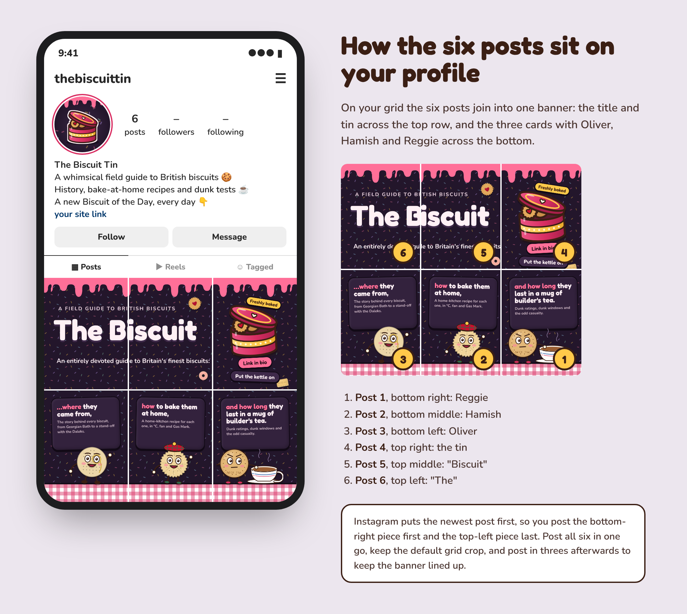

# Instagram hero banner

Six posts that together form one big banner across the top two rows of the profile grid.

## Posting order

Instagram puts the newest post top-left, so post them **in number order, 1 to 6**. Post 1 ends
up bottom-right and post 6 top-left:

| Grid position | File |
|---|---|
| Top left | `posts/post-6-of-6-row1-col1.png` |
| Top middle | `posts/post-5-of-6-row1-col2.png` |
| Top right | `posts/post-4-of-6-row1-col3.png` |
| Bottom left | `posts/post-3-of-6-row2-col1.png` |
| Bottom middle | `posts/post-2-of-6-row2-col2.png` |
| Bottom right | `posts/post-1-of-6-row2-col3.png` |

Things to know:

- **Post all six in one sitting** so they stay together.
- **Later posts push the banner down a row.** Post in threes to keep it lined up: three new posts
  move it down exactly one row. Pinning posts also changes the order.
- **Leave the grid thumbnail as it is.** Each post is 1080 × 1350, and the grid shows the middle
  of it. The pieces are drawn to join up at that default crop, so don't adjust the thumbnail when
  posting.
- Each post still looks complete when someone opens it in the feed.

## Captions

Each post appears in the feed on its own too, so give each a short caption. A matching set:

1. `…and how long they last in a mug of builder's tea ☕ Dunk ratings, dunk windows and the odd casualty. #DunkTest #BiscuitTin`
2. `…how to bake them at home 🧁 A home-kitchen recipe for every biscuit, in °C, fan and Gas Mark. #HomeBaking #BiscuitTin`
3. `…where they came from 📜 From Georgian Bath to a stand-off with the Daleks. #BiscuitHistory #BiscuitTin`
4. `Link in bio 🍪 Put the kettle on. #BritishBiscuits #BiscuitTin`
5. `An entirely devoted guide to Britain's finest biscuits 🇬🇧 #TeaAndBiscuits #BiscuitTin`
6. `Welcome to The Biscuit Tin 👋 A field guide to British biscuits. #BritishBiscuits #Biscuits #TeaTime #BiscuitTin`

## Changing it

`banner.html` is the whole banner as one page, laid out in grid space (3 × 1012 by 2 × 1350).
Keep important things away from the joins at x 1012 and 2024 and y 1350. Then run `node make.mjs`
(it needs Playwright with Chromium) to cut the six posts and redraw `grid-preview.png`.
`parts/` holds the three characters, captured from the Reels with transparent backgrounds.
